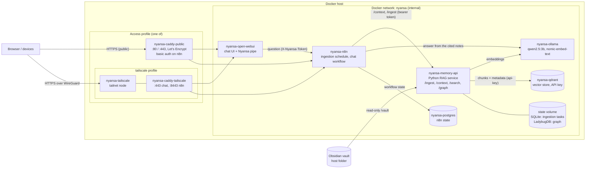
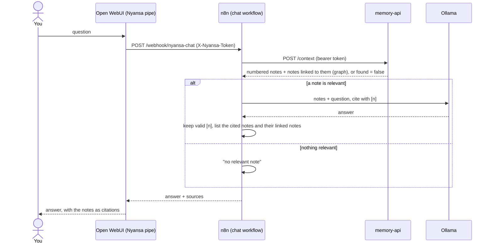

# Nyansa

[](LICENSE)
[](docker-compose.yml)

Nyansa is a self-hosted AI "second brain" built to run on a private server. It
is a Docker Compose stack of local LLMs, a vector store and a workflow engine,
wired to an Obsidian vault. Notes, models and data stay on infrastructure you
control. The name comes from the Akan word *nyansa*, "wisdom".

<!-- DEMO: remplacer par docs/demo.gif (enregistrement de Nyansa répondant à une question à partir du vault Obsidian) -->

## Features

- **Chat with your notes, with sources.** In Open WebUI, the "Nyansa" model
  answers from the notes of your vault and lists the notes it used (path and
  title). When no note is relevant, it says so instead of answering. Under the
  sources, "Notes liées" lists the notes your links connect to them.
- **Graph memory.** At every ingestion, memory-api rebuilds a graph of the
  vault in an embedded [LadybugDB](https://ladybugdb.com) file: notes,
  `[[wikilinks]]` and Markdown links resolved like Obsidian, backlinks, links
  to notes not written yet, and tags with their parents (`#projet/nyansa` is
  under `#projet`). `/graph/*` returns a note's links, backlinks and related
  notes, its neighbourhood, and vault statistics.
- **RAG over the vault (`memory-api`).** A Python service parses the notes
  (frontmatter, tags, `[[wikilinks]]`), splits them along their headings,
  embeds them with `nomic-embed-text` and stores them in Qdrant with their
  path, title, tags, section and content hash. Indexing is incremental: only
  changed notes are re-embedded and deleted notes are removed. Ingestions run
  in the background, with their state in SQLite.
- **Scheduled indexing with n8n.** Every 30 minutes, an n8n workflow starts an
  incremental ingestion and follows it to the end. A failure sends an e-mail.
- **Versioned workflows.** The n8n workflows and credentials live in `n8n/`,
  without any secret. They are imported when missing, never over your edits,
  and `scripts/n8n-export.sh` brings editor changes back into the repository.
- **Local inference with Ollama.** `qwen2.5:3b` (chat) and `nomic-embed-text`
  (embeddings), sized for CPU-only machines with limited RAM. `cpu`,
  `gpu-nvidia` and `gpu-amd` profiles.
- **Secure access, two modes.** Caddy serves Open WebUI and the n8n editor
  over HTTPS, either on a public domain (Let's Encrypt, basic auth in front of
  n8n) or on a Tailscale tailnet with no public port at all.
- **Push-to-deploy with rollback.** `git push prod main` builds an immutable
  release folder, backs up, deploys, waits for health and switches only on
  success. The previous release is restarted otherwise.
- **Backups.** Scripts to back up and restore the PostgreSQL database and every
  stateful volume, with checksums and retention.
- **Verifiable rules.** Scripts check the port exposure of all 9 profile
  combinations, refuse tracked secrets and check that every n8n webhook has
  its own authentication.

## Architecture



A question follows this path:



Only Caddy is reachable from outside. PostgreSQL, Qdrant, Ollama and
memory-api publish no port. n8n and Open WebUI listen on `127.0.0.1` for SSH
tunnels only. The Ollama container is named `nyansa-ollama` whatever the
hardware profile.

## Tech stack

| Component | Image (pinned default) | Role |
|---|---|---|
| n8n | `n8nio/n8n:2.40.7` | Workflows: scheduled ingestion, chat with sources, alerts |
| Ollama | `ollama/ollama:0.34.4` (`-rocm` for AMD) | Local LLM and embedding inference |
| Qdrant | `qdrant/qdrant:v1.19.1` | Vector store |
| PostgreSQL | `postgres:17.11-alpine` | n8n persistence |
| Open WebUI | `ghcr.io/open-webui/open-webui:v0.7.2` | Browser chat interface, with the Nyansa pipe (`open-webui/`) |
| Caddy | `caddy:2.11.4-alpine` | Reverse proxy, automatic HTTPS |
| Tailscale | `tailscale/tailscale:v1.102.5` | Private access (tailscale profile) |
| memory-api | built from `services/memory-api` (Python 3.14, FastAPI, asyncio, SQLite, LadybugDB) | Vault ingestion, semantic search, chat context, graph of the vault |
| `qwen2.5:3b` | Ollama model | Chat model |
| `nomic-embed-text` | Ollama model | Embedding model |

Each version can be overridden from `.env` (`N8N_VERSION`, `OLLAMA_VERSION`, ...).

## Security

Threat model: a single-owner server reachable from the internet. The goals
are that no internal service is reachable from outside, that every entry point
needs authentication over HTTPS, and that no secret lives in the repository.

| Measure | Where |
|---|---|
| PostgreSQL, Qdrant, Ollama and memory-api publish no port; they are only reachable on the internal `nyansa` network. | `docker-compose.yml` |
| memory-api requires a bearer token (constant-time comparison), runs as a non-root user with a read-only root filesystem, no Linux capabilities and a read-only vault mount; its only writable path is its state volume (SQLite tasks, graph file). | `docker-compose.yml`, `services/memory-api` |
| memory-api runs as one container with one process, the only owner of the graph file lock. | `docker-compose.yml`, `scripts/check-exposure.sh` |
| No container can write to the vault: n8n does not mount it, memory-api mounts it read-only. | `docker-compose.yml`, `scripts/check-exposure.sh` |
| n8n and Open WebUI are bound to `127.0.0.1`; outside access goes through Caddy. | `docker-compose.yml` |
| Docker bypasses UFW for published ports, so exposure is enforced in Compose and checked for all 9 profile combinations. | `scripts/check-exposure.sh` |
| HTTPS everywhere: Let's Encrypt (public) or tailnet certificates (tailscale). HSTS, `nosniff`, `frame-ancestors 'self'`, no `Server` header. | `caddy/` |
| n8n editor: HTTP basic auth (public profile) on top of the n8n login. Webhook paths are exempt from it, so every webhook requires its own Header Auth (`X-Nyansa-Token`), which a script verifies. | `caddy/Caddyfile.public`, `scripts/check-n8n-workflows.sh` |
| The chat webhook is refused by Caddy (404): only the Open WebUI pipe, on the internal network, calls it. | `caddy/internal-webhooks.caddy` |
| n8n credentials carry no secret: tokens and SMTP password are injected from `.env` through `CREDENTIALS_OVERWRITE_DATA`, so they are in neither the n8n database nor the exported workflows. | `docker-compose.yml`, `n8n/credentials/` |
| Tailscale profile: no port published on the host at all. | `docker-compose.yml` |
| Open WebUI: public sign-up disabled; the admin account is created from `.env` only when no user exists, so nobody can register first. | `docker-compose.yml` |
| Qdrant requires an API key, known only to memory-api. | `docker-compose.yml` |
| n8n gets an explicit list of variables, not the whole `.env`; workflows cannot read environment variables; cookies are secure. | `docker-compose.yml` |
| Compose refuses to start when a critical secret is missing. | `docker-compose.yml` |
| Images are pinned to verified versions. | `docker-compose.yml` |
| No secret in Git: `.env` is ignored, `.env.example` has placeholders only, and the pre-push hook scans for secret files and tokens. | `scripts/check-secrets.sh`, `hooks/pre-push` |
| Deployments run as a dedicated non-root user, from release folders that contain no `.env` and no development files. | `hooks/post-receive`, `scripts/build-publish.sh` |
| Backups before every deployment, restore script with checksum verification. | `scripts/backup.sh`, `scripts/restore.sh` |

Known limits: members of the `docker` group are root-equivalent on the host.
Backups are not encrypted: copy them to an encrypted destination. Ollama has no
authentication of its own and relies on network isolation. Every n8n
credential of type Header Auth, Bearer Auth or SMTP receives the Nyansa
secrets: use another type (Custom Auth) for other services.

## Deployment

Production runs from immutable release folders, never from a working tree:

1. `git push prod main` from your machine. The `pre-push` hook first scans the
   commit for secrets and builds a release from it with all checks.
2. On the server, `hooks/post-receive` builds `/opt/nyansa/releases/<sha>/`
   from the pushed commit, links the production `.env`, validates the Compose
   configuration, takes a backup, pulls images and starts the stack.
3. Once every container is healthy, `/opt/nyansa/current` points to the new
   release and old releases are pruned (5 kept by default). On failure,
   `current` is unchanged, the previous release is started again and the
   failed release is discarded. A crash loop is detected after 3 restarts,
   without waiting for the timeout.

[docs/DEPLOY.md](docs/DEPLOY.md) is the full from-scratch guide: server
preparation, secret generation, public or Tailscale access, firewall, first
deployment, admin accounts, the chat pipe, final checks, backups, restore,
rollback and secret rotation.

## Getting started (local)

### Prerequisites

- Docker with Docker Compose v2.24 or later.
- An existing folder for your Obsidian vault.

### Setup

```bash
git clone https://github.com/Geobatpo07/nyansa.git
cd nyansa
cp .env.example .env
scripts/install-hooks.sh   # optional: enables the pre-push checks
```

Edit `.env` and set at least:

| Variable | Purpose |
|---|---|
| `POSTGRES_PASSWORD` | PostgreSQL password |
| `N8N_ENCRYPTION_KEY` | Key n8n uses to encrypt stored credentials |
| `N8N_USER_MANAGEMENT_JWT_SECRET` | Secret for n8n session tokens |
| `N8N_WEBHOOK_TOKEN` | Secret of the n8n webhooks (`X-Nyansa-Token` header) |
| `WEBUI_SECRET_KEY` | Secret for Open WebUI sessions |
| `QDRANT_API_KEY` | Qdrant API key |
| `MEMORY_API_TOKEN` | Bearer token of memory-api (32+ characters) |
| `WEBUI_ADMIN_EMAIL`, `WEBUI_ADMIN_PASSWORD` | First Open WebUI admin account |
| `OBSIDIAN_VAULT_PATH` | Absolute path to your vault on the host |
| `SMTP_*`, `ALERT_EMAIL_*` | Optional: failure e-mails of the scheduled ingestion |

Generate each secret with `openssl rand -hex 32`, or in PowerShell with
`[System.Guid]::NewGuid().ToString("N")`.

### Run

Locally, no access profile is needed:

```bash
docker compose --profile cpu up -d --build
docker logs -f nyansa-ollama-pull-model   # first start: model download
```

The vault is indexed by n8n every 30 minutes. To start an ingestion now and
follow it (memory-api is internal, so the calls go through a container on the
`nyansa` network):

```bash
TOKEN=<MEMORY_API_TOKEN from .env>
docker exec nyansa-open-webui curl -s -X POST http://nyansa-memory-api:8080/ingest \
  -H "authorization: Bearer $TOKEN"          # 202, with the task id
docker exec nyansa-open-webui curl -s http://nyansa-memory-api:8080/ingest/status \
  -H "authorization: Bearer $TOKEN"
docker exec nyansa-open-webui curl -s -G http://nyansa-memory-api:8080/graph/notes \
  --data-urlencode "path=Projets/Nyansa.md" -H "authorization: Bearer $TOKEN"   # links, backlinks, related notes
```

Then install the chat once: in Open WebUI, *Admin Panel > Functions > +*,
paste [open-webui/src/nyansa_pipe.py](open-webui/src/nyansa_pipe.py), save,
enable it, and set `WEBHOOK_TOKEN` (your `N8N_WEBHOOK_TOKEN`) in its valves
(gear icon). Pick the **Nyansa** model in a new chat and ask about your notes.

The API, the indexing design and its limits are documented in
[services/memory-api/README.md](services/memory-api/README.md).

### Access

| Service | URL |
|---|---|
| Open WebUI | <http://localhost:3000> (log in with `WEBUI_ADMIN_EMAIL`) |
| n8n editor | <http://localhost:5678> |

Qdrant, Ollama and memory-api are internal only. To open the Qdrant dashboard temporarily:

```bash
docker run --rm --network nyansa -p 127.0.0.1:6333:6333 alpine/socat:1.8.1.3 \
  TCP-LISTEN:6333,fork,reuseaddr TCP:nyansa-qdrant:6333
# then http://localhost:6333/dashboard, with QDRANT_API_KEY
```

### Editing the workflows

Edit the workflows in the n8n editor, then bring them back into the repository:

```bash
scripts/n8n-export.sh          # every workflow of n8n/workflows, from nyansa-n8n
git diff n8n/workflows
```

A deployment imports only the workflows that do not exist yet in n8n, so your
edits are never overwritten. To replace an existing workflow with the version
of the repository, see [docs/DEPLOY.md](docs/DEPLOY.md#update-a-workflow).

### Tests and checks

The Python checks need [uv](https://docs.astral.sh/uv/) (it installs the
Python versions if missing); the shell checks need bash, Docker and jq.

```bash
(cd services/memory-api && uv sync && uv run pytest && uv run ruff check . && uv run mypy)
(cd open-webui && uv sync && uv run pytest && uv run ruff check . && uv run mypy)   # Python 3.11, as Open WebUI
scripts/check-exposure.sh --env-file .env.example   # port exposure, 9 profile combinations
scripts/check-secrets.sh HEAD                       # tracked secrets
scripts/check-n8n-workflows.sh                      # webhook auth, credentials without secrets
scripts/tests/check-secrets.test.sh                 # tests of the secrets scanner (throwaway Git repo)
scripts/tests/check-n8n-workflows.test.sh           # tests of the workflow checks
scripts/build-publish.sh HEAD                       # build and validate ./publish
```

`tests/fixtures/vault` holds four notes with distinct facts to try the chat end
to end: point `OBSIDIAN_VAULT_PATH` to it on a test stack and ask, for
example, how long the sourdough proofing takes.

## Project structure

```text
.
├── docker-compose.yml        # Services, volumes, network; hardware and access profiles
├── .env.example              # Template for secrets, URLs, profiles and paths
├── caddy/                    # Caddyfiles for the public and tailscale profiles, shared snippets
├── services/
│   └── memory-api/           # Python RAG service: ingestion tasks, search, chat context, graph (+ pytest)
├── open-webui/               # Nyansa pipe for Open WebUI (+ pytest, Python 3.11)
├── n8n/
│   ├── credentials/          # n8n credentials without secrets, imported when missing
│   └── workflows/            # Ingestion schedule, chat with sources, failure e-mail
├── scripts/
│   ├── backup.sh / restore.sh        # Backups of the database and volumes
│   ├── check-exposure.sh             # Port exposure rules for every profile combination
│   ├── check-secrets.sh              # Refuses tracked secrets
│   ├── check-n8n-workflows.sh        # Webhook auth and secret-free credentials
│   ├── n8n-export.sh                 # Exports edited workflows back to n8n/workflows
│   ├── tests/                        # Tests of the check scripts
│   ├── build-publish.sh              # Builds a release folder from a commit
│   ├── wait-healthy.sh               # Waits for a healthy stack
│   └── install-hooks.sh              # Installs the Git hooks
├── hooks/
│   ├── pre-push              # Dev machine: secrets scan and release build
│   └── post-receive          # Server: push-to-deploy with rollback
├── tests/fixtures/vault/     # Small vault for end-to-end chat checks
├── docs/
│   └── DEPLOY.md             # From-scratch deployment and operations guide
└── LICENSE                   # Apache License 2.0
```

`publish/`, `backups/` and `shared/` are generated locally and ignored by Git.

## Roadmap

- Sync the Obsidian vault across devices with Syncthing.
- CI: lint, typecheck, tests, workflow checks and Compose validation.
- Graph-expanded context: give the model the notes linked to its sources,
  not only list them. Deferred from the graph memory phase until its effect can
  be measured on a set of reference questions; for now the linked notes are
  shown to you and never sent to the model.

## Credits

Nyansa started as a fork of the
[n8n self-hosted AI starter kit](https://github.com/n8n-io/self-hosted-ai-starter-kit),
released under the Apache License 2.0. The base Compose layout and the
first-boot import of n8n come from that project.

Changes made in Nyansa:

- Renamed services, volumes and network under the `nyansa` namespace.
- Added the Open WebUI service and the Nyansa pipe.
- Replaced `llama3.2` with `qwen2.5:3b` and added the `nomic-embed-text`
  embedding model.
- Replaced the default secrets in `.env.example`.
- Replaced the demo workflow and credentials with the Nyansa workflows and
  secret-free credentials.
- Added the RAG service, the security hardening, reverse proxy, backups and
  push-to-deploy pipeline described above.

This project is distributed under the Apache License 2.0. See [LICENSE](LICENSE).
