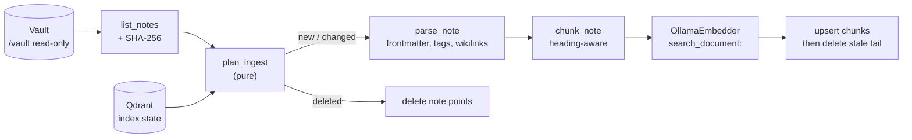
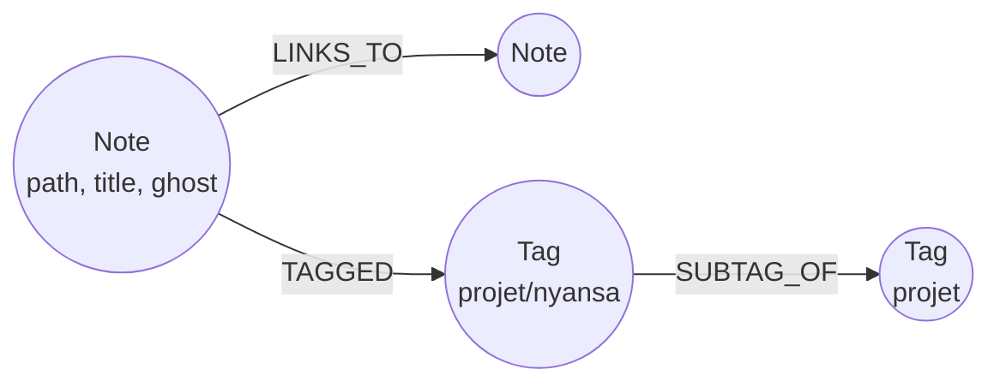

# memory-api

Python service that turns the Obsidian vault into a searchable memory:
it parses the notes, splits them along their headings, embeds the chunks with
`nomic-embed-text` (Ollama) and stores them in Qdrant with their metadata.
`/search` returns the most relevant chunks with the note they come from, and
`/context` prepares them for a chat answer that cites its notes. Each
ingestion also rebuilds a graph of the vault (links, backlinks, tags), served
by `/graph/*`.

Python 3.14, asyncio, FastAPI, Pydantic, httpx, SQLite, LadybugDB; pytest,
ruff, mypy (strict); dependencies locked with uv, with their hashes.

## API

Every route except `/health` requires `Authorization: Bearer <MEMORY_API_TOKEN>`.
The service is only reachable on the internal Docker network, at
`http://nyansa-memory-api:8080`.

### `GET /health`

`200` when Ollama and Qdrant answer (Qdrant with the API key), `503` otherwise.

```json
{ "status": "ok", "checks": { "ollama": "ok", "qdrant": "ok" }, "ingesting": false }
```

### `POST /ingest`

Body (optional): `{ "mode": "incremental" | "full" }`, default `incremental`.

- `incremental`: only notes whose content hash or index version changed are
  reindexed.
- `full`: every note is reindexed.
- In both modes, notes deleted from the vault are removed from the index.

The ingestion runs in the background: the answer is `202` with the task and a
`Location: /ingest/status/{id}` header to follow it.

```json
{
  "id": "c1c4153c-d347-4ff6-a5a9-a57cd27d638a",
  "mode": "incremental",
  "status": "running",
  "startedAt": "2026-10-20T00:21:03.660Z",
  "finishedAt": null,
  "progress": { "total": 0, "done": 0 },
  "report": null,
  "error": null
}
```

One ingestion runs at a time. A call while one runs gets `409`, with the
running task and its `Location`:

```json
{ "error": "an ingestion is already running", "current": { "id": "c1c4153c-...", "status": "running" } }
```

### `GET /ingest/status/{id}` and `GET /ingest/status`

`/ingest/status/{id}` returns one task (`404` if unknown, `400` if the id is
not a UUID). `progress` counts the notes to index and the notes done. When the
task ends, `finishedAt` is set and `status` is:

| Status | Meaning |
|---|---|
| `completed` | The run ended; notes that failed one by one are in `report.errors`. |
| `aborted` | Ollama or Qdrant failed 3 times in a row; see `report.aborted`. |
| `failed` | The run could not complete (for example Qdrant down at the start); see `error`. |
| `interrupted` | The service stopped (deployment, crash) during the run. |

```json
{
  "id": "c1c4153c-...",
  "status": "completed",
  "progress": { "total": 4, "done": 4 },
  "report": {
    "mode": "incremental",
    "startedAt": "2026-10-20T00:21:03.660Z",
    "durationMs": 2290,
    "notes": { "scanned": 4, "indexed": 4, "unchanged": 0, "deleted": 0, "failed": 0, "skipped": 0 },
    "chunks": { "upserted": 6 },
    "errors": [],
    "graph": { "notes": 4, "ghosts": 1, "links": 5, "tags": 7 },
    "graphError": null
  },
  "error": null
}
```

`report.graph` counts the graph rebuilt at the end of the run, from every note
of the vault (even when no note changed). When the graph cannot be rebuilt,
`graph` is `null` and `graphError` says why; the notes are indexed anyway.

`/ingest/status` returns `{ "current": <running task or null>, "recent": [<20 latest tasks>] }`.

Tasks are kept in a SQLite file (`STATE_PATH`, on the `nyansa_memory_api_state`
volume), so their state survives a restart; the 100 latest are kept. A task
interrupted by a restart is not resumed: the next incremental run indexes the
notes it did not record.

A note that fails (for example an embedding error) is listed in `errors`. Its
previous version stays in the index, and the next run retries it.

When 3 notes in a row fail on Ollama or Qdrant (service down, model
missing), the run stops instead of failing every remaining note: the report
gets an `aborted` message and `notes.skipped` counts the notes not attempted.
They are retried by the next run.

The first full ingestion is bounded by the embedding speed. On a CPU-only
host, expect about 2 chunks per second (a 500-note vault of 2,250 chunks took
17 minutes in testing). Later incremental runs only embed the changed notes
(8 changed notes: 11 seconds).

### `POST /search`

```json
{ "query": "Comment je déploie Nyansa ?", "limit": 5, "tags": ["projet"], "minScore": 0.5 }
```

`limit` 1 to 50 (default 5). `tags` and `minScore` are optional.

```json
{
  "query": "Comment je déploie Nyansa ?",
  "results": [
    {
      "score": 0.662,
      "path": "projets/Nyansa.md",
      "title": "Nyansa",
      "section": "Nyansa > Déploiement",
      "tags": ["ia", "projet"],
      "chunkIndex": 2,
      "text": "Un `git push prod main` construit une release, ..."
    }
  ]
}
```

### `POST /context`

The notes to answer a question from, numbered so the answer can cite them.

```json
{ "query": "Combien de temps dure l'apprêt de mon pain au levain ?", "limit": 8 }
```

`limit` 1 to 20 chunks (default 8); `tags` and `minScore` as for `/search`,
`minScore` defaulting to `CONTEXT_MIN_SCORE`. The chunks are grouped by note;
notes are numbered by their best chunk, and the context stays under
`CONTEXT_MAX_CHARS`.

```json
{
  "query": "Combien de temps dure l'apprêt de mon pain au levain ?",
  "found": true,
  "sources": [
    { "n": 1, "path": "Recettes/Pain au levain.md", "title": "Pain au levain",
      "sections": ["Pain au levain > Fermentation"], "score": 0.751 }
  ],
  "context": "<note number=\"1\">\nSection: Pain au levain > Fermentation\nPointage de 4 heures ...\n</note>",
  "related": [
    { "path": "Recettes/Levain.md", "title": "Levain", "linkedTo": [1] }
  ]
}
```

`found` is `false` (no source, empty context) when no chunk reaches the
threshold: the caller can then say that no note is relevant instead of letting
the model invent. Each note is wrapped in a `<note number="n">` tag: with
`qwen2.5:3b`, numbered headers were copied into the answers, tags are not.

`related` lists up to 5 notes the graph links to or from the sources
(`linkedTo`: their numbers), sources excluded, the notes linked to the most
sources first. They are meant to be shown under the answer and are **not** in
`context`: giving them to the model is deferred until its effect is measured
on a set of reference questions. Without the graph, `related` is empty and
the rest of the answer is unchanged.

Errors: `400` invalid body, `401` missing or wrong token, `413` body over
64 KiB, `502` Ollama or Qdrant failure.

### `GET /graph/notes?path=`

A note of the graph, by its vault path, passed as a query parameter (encoded:
`?path=Sport/Course%20%C3%A0%20pied.md`; `curl -G --data-urlencode` does it).

```json
{
  "path": "Projets/Nyansa.md",
  "title": "Nyansa",
  "ghost": false,
  "tags": ["projet/nyansa"],
  "links": [
    { "path": "Infra/Docker.md", "title": "Docker", "ghost": false },
    { "path": "Plus tard.md", "title": "Plus tard", "ghost": true }
  ],
  "backlinks": [{ "path": "Index.md", "title": "Index", "ghost": false }],
  "related": [{ "path": "Infra/Backup.md", "title": "Backup", "sharedTags": ["projet"] }]
}
```

- `ghost`: the target of a link to a note that does not exist yet. Ghosts can
  be requested too, by their path (`Plus tard.md`).
- `related`: up to 10 notes sharing a tag with this one, parent tags
  included (`projet/nyansa` and `projet/sport` share `projet`), the most
  shared tags first.

### `GET /graph/neighbors?path=&depth=1|2`

The notes within `depth` links of a note (default 1), following links in
both directions, and the links between them, for a graph view:

```json
{
  "path": "Infra/Docker.md",
  "depth": 1,
  "nodes": [{ "path": "Infra/Backup.md", "title": "Backup", "ghost": false }, "..."],
  "edges": [{ "source": "Infra/Docker.md", "target": "Infra/Backup.md" }, "..."]
}
```

### `GET /graph/stats`

```json
{ "notes": 512, "ghosts": 37, "links": 1480, "tags": 64, "orphans": 41 }
```

`orphans`: existing notes that link to no note and that no note links to (a
link to a ghost counts as a link).

Errors of the `/graph` routes: `400` missing or invalid parameter, `404`
unknown note, `503` graph unavailable (see [Graph](#graph)), with the reason
in `detail`. The other routes never depend on the graph.

## How it works



- **Parsing** (`src/markdown.py`): YAML frontmatter; title from
  `title:`, the first H1, or the file name; tags from the frontmatter and
  inline `#tags`, lower-cased; `[[target#heading|alias]]` and `![[embeds]]`.
  Fenced code and inline code are ignored. Invalid YAML is reported, not
  fatal.
- **Chunking** (same module): one section per ATX heading, with
  its heading path (`Setup > Docker`). Paragraphs are packed up to
  `CHUNK_MAX_CHARS` (1500); a code block is never split unless it exceeds the
  limit alone; oversized blocks are split by lines, sentences, then
  characters. A note without text is indexed by its title.
- **Embedding**: each chunk is embedded with its note title and section as a
  header, with the `search_document:` / `search_query:` prefixes that
  `nomic-embed-text` expects.
- **Storage**: one Qdrant point per chunk. The point id is a UUID derived from
  `path + chunk index`, so reindexing a note overwrites its points; chunks
  beyond the new count are deleted afterwards. The note is never missing from
  the index during an update. The first chunk, which carries the note hash, is
  written last: if a run stops in the middle of a note, the note keeps its old
  hash and the next run indexes it again. Payload: `path`, `title`, `tags`, `links`,
  `section`, `chunk_index`, `chunk_count`, `text`, `note_hash`,
  `index_version`, `indexed_at`. `path`, `tags` and `chunk_index` are indexed.
- **Incremental state** lives in Qdrant itself (first chunk of each note), so
  there is no second database to keep in sync. `index_version` changes with
  the embedding model or chunk size, which reindexes everything.
- **Architecture**: the ingestion and search logic depend on two protocols
  (`Embedder`, `VectorStore` in `src/domain.py`). `OllamaEmbedder`
  and `QdrantStore` (`clients.py`) implement them over one shared httpx
  client; tests use in-memory fakes. The vault is read in a worker thread so
  `/health` keeps answering during an ingestion.

### Graph

`src/graph.py` keeps the graph in an embedded [LadybugDB](https://ladybugdb.com)
file (`GRAPH_PATH`, on the state volume), queried in Cypher:



- **Rebuilt, not updated.** At the end of every ingestion, every note of the
  vault is parsed again and the graph is replaced in one transaction (1.2 s
  for 2,000 notes and 6,000 links). A renamed or deleted note changes the
  resolution of the links pointing to it, so rebuilding is simpler and always
  right. Readers see the old graph or the new one, never a mix.
- **Links are resolved like Obsidian.** `[[Name]]` targets the note
  `Name.md` wherever it is, ignoring case and Unicode normalization (macOS
  writes accents decomposed); when several notes share the name, the shortest
  path wins. `[[folder/Name]]` targets that path, or the shortest path ending
  with it. `#heading`, `|alias` and `![[embeds]]` of notes link to the note. A
  Markdown link `[text](folder/Name.md)` (or `<folder/Name with spaces.md>`,
  or `%20`-encoded) is resolved from the note's folder, then from the vault
  root, then by name. Links inside code blocks and inline code are ignored.
- **Ghosts and attachments.** A link to a missing note creates a ghost note,
  the way Obsidian shows notes to write. A link to a file that is not a note
  (`![[image.png]]`, `[[doc.pdf]]`, any target with a file extension, and any
  Markdown link not ending in `.md`) creates nothing.
- **One owner.** LadybugDB locks the file: only one process can open it.
  memory-api runs a single uvicorn process (no workers) in a single container
  (`scripts/check-exposure.sh` refuses a scaled service). The graph is closed
  on shutdown, and Compose stops the old container before starting the new one
  on a deployment or a rollback. After a crash or a SIGKILL, the kernel
  releases the lock with the process, and LadybugDB replays its write-ahead
  log on the next open.
- **Unavailable or unreadable.** Opening the graph can fail for two kinds of
  reasons, told apart by LadybugDB's message:
  - the file is **unreadable** (not a LadybugDB file, damaged pages or log,
    written by another LadybugDB version): the graph file and its own `.wal`
    and `.shadow` files are deleted, never anything else in `/state`, and an
    empty graph is created; the next ingestion fills it;
  - anything else, first of all the **lock held by another process**, but
    also a permission error or an unknown message: nothing is deleted, the
    `/graph` routes answer `503` and the next call tries again.

  Only messages known to mean damage lead to a deletion, so a new LadybugDB
  message is treated as "unavailable", never as "unreadable". The tests open
  the graph from a second process to check that a held lock never deletes it.

## Configuration

| Variable | Default | |
|---|---|---|
| `MEMORY_API_TOKEN` | (required, 32+ chars) | Bearer token |
| `QDRANT_API_KEY` | (required) | Qdrant API key |
| `QDRANT_URL` | `http://nyansa-qdrant:6333` | |
| `QDRANT_COLLECTION` | `obsidian_notes` | |
| `OLLAMA_URL` | `http://nyansa-ollama:11434` | |
| `EMBEDDING_MODEL` | `nomic-embed-text` | Changing it reindexes all notes |
| `CHUNK_MAX_CHARS` | `1500` | 200 to 8000; changing it reindexes all notes |
| `VAULT_PATH` | `/vault` | Mounted read-only |
| `STATE_PATH` | `/state/memory-api.db` | SQLite file of the ingestion tasks, on a writable volume |
| `GRAPH_PATH` | `/state/graph.lbug` | LadybugDB file of the graph, on the same volume; rebuilt from the vault |
| `CONTEXT_MIN_SCORE` | `0.65` | `/context`: minimum similarity of a relevant chunk (-1 to 1) |
| `CONTEXT_MAX_CHARS` | `6000` | `/context`: maximum size of the text given to the model |
| `MEMORY_API_PORT` | `8080` | |
| `LOG_LEVEL` | `info` | `fatal`, `error`, `warn`, `info`, `debug`, `trace` or `silent` |

The vector size is read from the model at the first ingestion. A collection
created with another size is refused with an explicit error.

## Development

```bash
cd services/memory-api
uv sync                     # .venv with the locked dependencies
uv run pytest               # parsing, chunking, ingestion tasks, context, adapters, API
uv run ruff check . && uv run ruff format --check .
uv run mypy                 # strict
STATE_PATH=./state.db uv run python -m src.main   # needs the variables below
```

Tests never call Ollama or Qdrant: the adapters are tested against
`httpx.MockTransport`, and the ingestion and API tests use in-memory fakes
with a temporary vault on disk. `tests/test_qdrant_integration.py` runs
against a real Qdrant when `QDRANT_TEST_URL` is set (see the file).

The service was first written in TypeScript. `tests/golden` holds notes and
the values that implementation computed for them (point ids, `index_version`,
hashes, titles, tags, links, chunks); `tests/test_golden.py` requires the same
values, so an index built before the port stays valid and nothing is
reindexed.

Calling the running service from the Docker network (with `MEMORY_API_TOKEN`
from `.env`):

```bash
docker exec nyansa-open-webui curl -s -X POST http://nyansa-memory-api:8080/ingest \
  -H "authorization: Bearer $MEMORY_API_TOKEN"
docker exec nyansa-open-webui curl -s http://nyansa-memory-api:8080/ingest/status \
  -H "authorization: Bearer $MEMORY_API_TOKEN"
docker exec nyansa-open-webui curl -s -X POST http://nyansa-memory-api:8080/search \
  -H "authorization: Bearer $MEMORY_API_TOKEN" -H 'content-type: application/json' \
  -d '{"query": "What did I write about Docker?"}'
```

## Known limits

- Only Markdown files are indexed (no PDF or image content). Notes are read as
  UTF-8; a file that is not valid UTF-8 is decoded as Windows-1252 and logged.
- Setext headings (`Title` underlined with `===`) are not treated as
  headings.
- `nomic-embed-text` is trained mostly on English. French notes are found,
  with less precise ranking; a multilingual model can be set with
  `EMBEDDING_MODEL`. A question in another language than the notes scores
  lower and may find nothing.
- The relevance threshold of `/context` (`CONTEXT_MIN_SCORE`) was measured on
  a small French vault: relevant questions scored 0.68 to 0.76, unrelated ones
  up to 0.65. Check it on your own vault with `/search` and adjust it: raise it
  if answers cite unrelated notes, lower it if relevant notes are missed.
- Graph: a note name with a dot followed by letters (`[[Node.js]]`) looks like
  a file name, so a link to it creates no ghost while the note does not
  exist; once it exists, the link resolves normally. Markdown links are taken
  as note links only when they end in `.md`, and reference-style links
  (`[text][ref]`) are not read. Only fenced and inline code is skipped: a link
  in an indented code block counts. One link is kept per pair of notes,
  without its heading or alias.
- Graph: the `/graph` routes wait while the graph is rebuilt (about a second).
  A new or empty graph file stays empty until the next ingestion (every 30
  minutes, or `POST /ingest`). LadybugDB is still in 0.x: a version that
  cannot read the file is handled as an unreadable file, rebuilt by the next
  ingestion.
